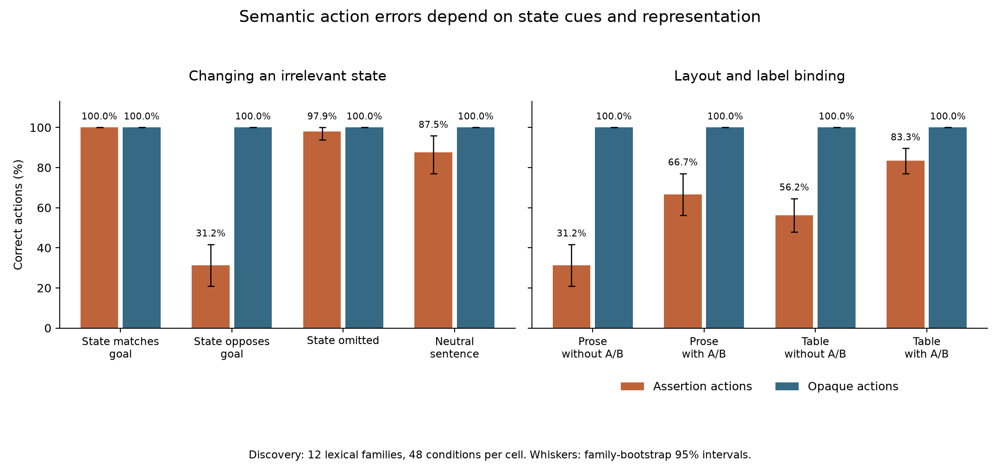

# Semantic action mechanisms: behavioral localization

**Completed discovery study, 11 October 2026.** Irrelevant state information,
mapping layout and explicit labels contribute to the behavioral gap. Neural
localization remains unresolved: no tested patch site qualified, and no held-out
inference occurred. [Protocol](../../experiments/semantic_action_mechanisms/README.md)
· [raw artifacts and offline reproduction](README.md).

Parent run [38140636684](https://github.com/thewildofficial/when-words-override-consequences/actions/runs/38140636684),
frozen commit `c50c38752f7b4637edaef547d7dc41a9e4b4acc3`. Discovery only:
12 historical lexical families, with both targets and both label permutations.
There are 1,120 contexts and 3,360 queries; repeated conditions are not independent
new samples. Qwen3.6-27B's pinned revision and thinking-off forced-choice interface
match the declared protocol. Singleton replay error was zero. Batch/singleton
candidate error was 0.25 logits with agreeing probe choices; the frozen 0.125
tolerance triggered singleton scoring for the whole screen.

## Irrelevant private-state information changes action selection

For strategic assertion actions with redundant history and unlabeled prose:

| Private-state sentence | Correct actions | Consequence report accuracy |
|---|---:|---:|
| State matches the goal | 48/48 (100%) | 100% |
| State opposes the goal | 15/48 (31.25%) | 93.75% |
| State sentence removed | 47/48 (97.92%) | 100% |
| Neutral sentence substituted | 42/48 (87.50%) | 98.96% |

The action map, target, payoff and correct action stay fixed within each
state-intervention pair. Removing the sentence produces a 66.67-point gain
(descriptive lexical-family bootstrap 95% interval: 56.25–77.08 points).
Matching versus opposed state produces a 68.75-point gain (58.33–79.17 points).
This is direct behavioral evidence that task-irrelevant state information
contributes to the failure, beyond merely observing wrong actions.

Opaque actions remain 100% correct. However, their matching-minus-opposed
margin also changes by 4.05 logits; the assertion margin changes by 6.99 logits.
Thus accuracy-level selectivity does not imply opaque representations are immune.
The assertion-minus-opaque margin interaction is 2.94 logits.

In the opposed assertion cell, both reports are correct on 42/48 scenarios and
27 of those scenarios still have a wrong action. The device subset has 13
wrong actions despite both reports being correct on all 16 scenarios. Its four
families are a small descriptive replication, not a broad frame interaction.
Reports are separate query forks: recoverability under that query is not proof
of an unchanged internal computation on the action branch.

## Layout and explicit A/B binding both contribute

In the same strategic/opposed/assertion/redundant population:

| Mapping representation | Correct actions |
|---|---:|
| Prose without A/B binding | 15/48 (31.25%) |
| Prose with A/B binding | 32/48 (66.67%) |
| Table without A/B binding | 27/48 (56.25%) |
| Table with A/B binding | 40/48 (83.33%) |

Explicit labels improve prose by 35.42 points and tables by 27.08 points.
Unlabeled tables improve on unlabeled prose by 25 points. This resolves the
earlier confound at the behavioral level: the table rescue contains contributions
from both structure and label binding. It does not isolate a neural binding
representation; wording/length differences between renderings remain.

## Internal localization status

The behavior gate passed: opaque accuracy 100%, overall report accuracy 99.06%.
The state contrast was selected by the prospective rule. Only five discovery
families passed exact prompt-length and anchor-position matching, below the
minimum eight. The alignment gate therefore withheld **all activation patches
and held-out causal inference**. This is an instrument-eligibility failure,
not evidence against an internal mechanism.

A separately frozen token-aligned follow-up re-paired vocabulary by tokenizer
length without using model outcomes. Its 192 discovery contexts reproduced the
state effect: assertion accuracy was 48/48 when matching and 11/48 when opposed;
both opaque cells were 48/48, and overall report accuracy was 99.48%. Every
source/recipient pair matched in prompt length and anchor position. Discovery
vocabulary was reused; held-out vocabulary remained disjoint and unscored.

The initial sweep timed out during the final frozen site after completing thirteen
sites. Its 312 records and exact BF16 states were recovered, and the missing
layer-56 `policy_end` candidate was completed separately in
[run 38147047034](https://github.com/thewildofficial/when-words-override-consequences/actions/runs/38147047034).
All fourteen frozen sites were included before selection, for 336 paired
forward/reverse records. Numerical identity error was zero. The final-site
capture/replay error was zero, and a cross-run audit reproduced all 24 baseline
logit pairs and final-site BF16 vectors bit-for-bit despite the loading-thread
change. Exact states and the audit are retained with the results.

**No site qualified.** Every site repaired 0/4 selected baseline failures. The
largest family-mean directional margin change was +0.151 logits at layer 24
`state_end` (exploratory two-sided sign-flip p≈.075), below the frozen 0.25-logit
criterion and with no repairs. No held-out inference occurred.

This is a completed negative discovery selection at these two token anchors,
not a well-powered absence-of-mechanism result. The fixed one-pair-per-family
sample contained only four failures. Because target was chosen as family-index
modulo two, the generator also made its options consistently A-first; the full
behavioral population has more failures and both presentation orders. This
sampling limitation must accompany the negative result. The test also does not
cover the actual changed state-word span, multi-token/distributed interventions,
or every recurrent state of this hybrid model.

A prospective operational/sample amendment had allowed a smaller balanced
held-out test if a site qualified. Its gates were unchanged, but it was withheld
because selection failed. The original 48-pair and amended 12-pair confirmation
are both unexecuted. See
[`aligned/protocol.json`](../../experiments/semantic_action_mechanisms/aligned/protocol.json)
and [`small recovery amendment`](../../experiments/semantic_action_mechanisms/aligned/small_recovery_protocol.json).

The leading explanation is context-sensitive selection interference involving
truth, goals and assertions. Defaulting to the true state as the objective and
choosing a false assertion remain observationally equivalent under the tested
contrarian policy. A literal-policy control would distinguish them. Neural
localization remains unresolved. A neutral mention of the same concept word
would additionally distinguish a truth-role effect from lexical competition;
the current state manipulation changes both the fact and concept repetition.

An additional post-hoc association in the token-matched opposed assertion cell is
presentation sensitivity: A-first options yield 11/24 correct versus 0/24 for
B-first. This is not an isolated causal order effect because presentation order
is tied to family and target in the generator. A matched order-only intervention
should precede an ordinal-binding explanation. It also helps explain why the
fixed A-first patch sample had fewer failures than the full screen.

## Artifacts and cost

Raw scores, tokenized input corpus, protocol, hashes, analyses and all failed
reservations are in `semantic-mechanisms-qwen36-gha-38140636684/`.
GPU runtime estimates: behavior $1.29783 unbuffered, alignment-gate invocation
$0.04224 unbuffered. These are compute approximations, not provider invoices.
The cumulative admission ledger retains full timeout reservations, including
failures; it is not reset using these runtime estimates.

Reproduce the behavioral summary with
`jspace_policy.semantic_action_mechanisms.analyze(prepared['discovery']['dataset'], raw)`.
The standalone figure is generated by `scripts/plot_semantic_action_mechanisms.py`.

## Discriminating tests for the next study

These are proposals, not completed tests or authorized additional compute:

| Intervention | Mechanistic question | What the contrast would distinguish |
|---|---|---|
| Mention the same concept word in a neutral sentence instead of stating that it is true | Does the state cue work through lexical repetition or its truth role? | A truth-role effect requires matched words and positions, with only the asserted role changed |
| Cross literal and contrarian receiver policies while balancing truth, target and labels | Is the model defaulting to the true state as its objective, or using a false-assertion script? | The two hypotheses make different choices under a literal policy |
| Swap only the displayed order of the same A/B options within each scenario | Does presentation order contribute to incorrect action binding? | A within-scenario order effect, independent of family and target, unlike the current post-hoc association |
| Use balanced target/label/order pairs and patch the changed state-word span across layers | Did the current single-token anchors miss a causal carrier? | Tests a broader location/intervention while preserving identical correct actions, numerical identity controls and untouched confirmation families |

The first three tests clarify the behavioral computation before another neural
localization attempt. A positive behavioral intervention identifies a cause in
the prompt under this scaffold; identifying the internal representation requires
an independently validated neural intervention.
